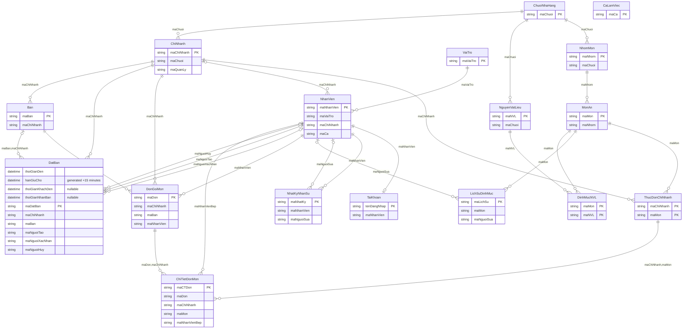
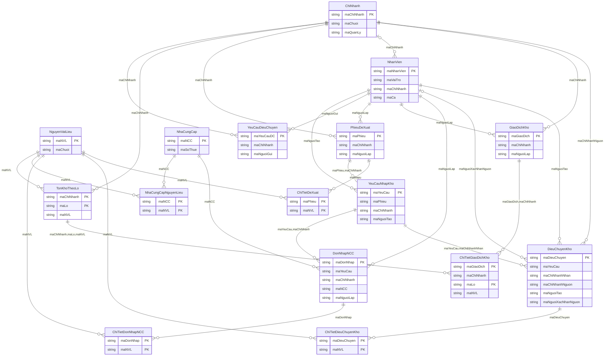
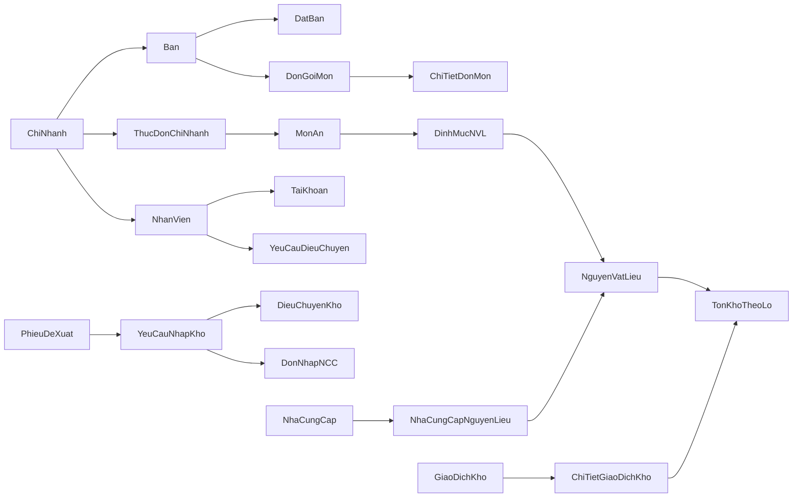

# ERD, domain và class theo 32 sequence

## ERD vật lý đầy đủ

Hai sơ đồ dưới hợp lại là cùng một ERD; ChiNhanh/NhanVien xuất hiện ở cả hai để dễ đọc. Hai bảng kỹ thuật được tách khỏi domain. Thuộc tính chi tiết xem TU_DIEN_DATABASE.md.

### Nhóm 1

### Nhóm 2

Các cạnh ERD thể hiện tham chiếu; FK nullable cho phép vắng cha ở dòng cụ thể (ví dụ DatBan.maBan chưa gán, ChiNhanh.maQuanLy chưa chọn). TaiKhoan.maNhanVien là UNIQUE: một nhân viên tối đa một tài khoản. Xem FK ghép trong SQL để biết điều kiện cùng chi nhánh.

## Domain khái niệm

## Control và phương thức theo nhóm sequence

```mermaid
classDiagram
    class DatBanControl {
        <<Control>>
        +taoDonDatBan(data)
        +theoDoiTrangThai(soDienThoai)
        +kiemTraBanPhuHop(actor,maDatBan)
        +xacNhanDatBan(actor,maDatBan,maBan)
        +ghiNhanKhachDen(actor,maDatBan)
        +taoDonTaiQuay(actor,data)
        +traCuuDatBan(actor,term,date,status,branch)
        +chiTiet(actor,maDatBan,branch)
        +tuHuyQuaHan()
        +huyDatBan(actor,maDatBan,lyDo)
    }
    class NhanSuControl {
        <<Control>>
        +xem(tieuChi)
        +them(data)
        +sua(maNhanVien,data)
        +nghiViec(maNhanVien)
    }
    class BepControl {
        <<Control>>
        +tiepNhan(maCTDon)
    }
    class DinhMucControl {
        <<Control>>
        +luuCongThuc(maMon,danhSachNVL)
    }
    class ChiNhanhControl {
        <<Control>>
        +them(data)
        +xem(maChiNhanh)
        +sua(maChiNhanh,data)
        +ngungHoatDong(maChiNhanh)
    }
    class BoSungKhoControl {
        <<Control>>
        +taoTuPhieu(maPhieu)
        +lapDieuChuyen(maYeuCau,data)
        +lapNhapNCC(maYeuCau,data)
        +xacNhanNguon(maDieuChuyen,quyetDinh,lyDo)
    }
    class MonAnControl {
        <<Control>>
        +them(data)
        +danhSach()
        +sua(maMon,data)
        +ngungBan(maMon)
        +tim(tuKhoa)
        +chiTiet(maMon)
    }
    class GoiMonControl {
        <<Control>>
        +taoDon(maBan,dsMon)
        +themMon(maDon,dsMon)
        +huyMon(maCTDon,lyDo)
    }
    class DieuChuyenNhanVienControl {
        <<Control>>
        +taoYeuCau(data)
    }
    class KhoControl {
        <<Control>>
        +danhSach(tieuChi)
        +them(data)
        +sua(data)
        +ngungSuDung(ma)
        +ghiBienDong(data)
    }
    class BaoCaoKhoControl {
        <<Control>>
        +xem(boLoc)
        +xuatExcel(boLoc)
        +xuatPDF(boLoc)
    }
    DatBanControl ..> DatBan : dung
    DatBanControl ..> Ban : dung
    DatBanControl ..> ChiNhanh : dung
    NhanSuControl ..> NhanVien : dung
    NhanSuControl ..> TaiKhoan : dung
    NhanSuControl ..> NhatKyNhanSu : dung
    BepControl ..> DonGoiMon : dung
    BepControl ..> ChiTietDonMon : dung
    DinhMucControl ..> MonAn : dung
    DinhMucControl ..> DinhMucNVL : dung
    DinhMucControl ..> NguyenVatLieu : dung
    DinhMucControl ..> LichSuDinhMuc : dung
    ChiNhanhControl ..> ChiNhanh : dung
    BoSungKhoControl ..> PhieuDeXuat : dung
    BoSungKhoControl ..> YeuCauNhapKho : dung
    BoSungKhoControl ..> DieuChuyenKho : dung
    BoSungKhoControl ..> DonNhapNCC : dung
    BoSungKhoControl ..> NhaCungCapNguyenLieu : dung
    BoSungKhoControl ..> TonKhoTheoLo : dung
    MonAnControl ..> MonAn : dung
    MonAnControl ..> NhomMon : dung
    GoiMonControl ..> Ban : dung
    GoiMonControl ..> DonGoiMon : dung
    GoiMonControl ..> ChiTietDonMon : dung
    GoiMonControl ..> ThucDonChiNhanh : dung
    DieuChuyenNhanVienControl ..> YeuCauDieuChuyen : dung
    KhoControl ..> NguyenVatLieu : dung
    KhoControl ..> TonKhoTheoLo : dung
    KhoControl ..> GiaoDichKho : dung
    KhoControl ..> ChiTietGiaoDichKho : dung
    BaoCaoKhoControl ..> TonKhoTheoLo : dung
    BaoCaoKhoControl ..> GiaoDichKho : dung
    BaoCaoKhoControl ..> ChiTietGiaoDichKho : dung
```

BCE áp dụng chung: Actor → Boundary của use case → Control tương ứng → Entity/repository PDO. Các lớp Control trên là đề xuất phân tách cho PHP thuần, không bắt buộc framework. Không thêm phương thức ngoài 32 use case. `KhoControl.ghiBienDong` là thao tác nội bộ để giữ sổ khi quản lý kho, không là use case mới.
## Bổ sung đặt bàn ngày 30/10/2026

DatBanControl ở trên dùng tên phương thức đã hiện thực trong modules/dat-ban; các Control module khác vẫn là hợp đồng đề xuất. Domain DatBan phân biệt thời điểm đặt dự kiến, hạn giữ chỗ, giờ khách thực sự đến và giờ được nhận bàn. Khách đến đúng hạn nhưng bàn bận không bị coi là vắng mặt. Hai thuộc tính mới không tạo thêm thực thể/quan hệ hay bảng nghiệp vụ. Xem ../dat-ban-ca-nhan/SEQUENCE_CAP_NHAT.md để đối chiếu sáu sequence với code và test.
